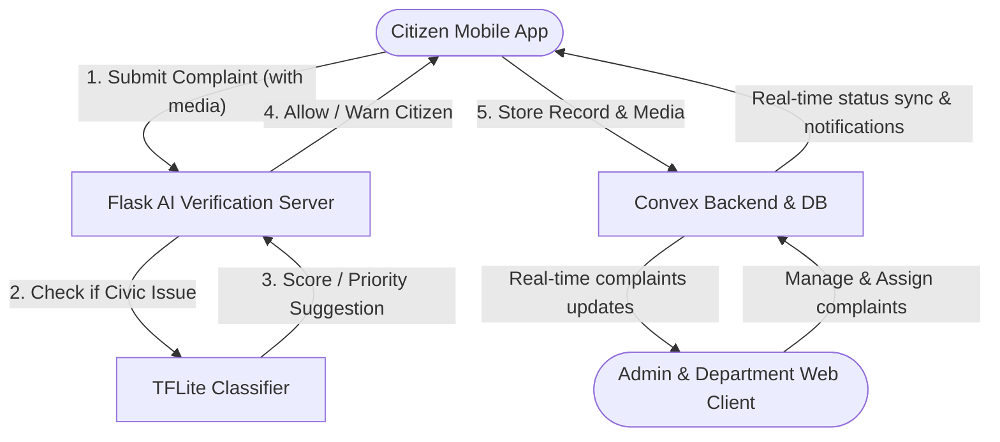

# 🏛️ Samadhan: AI-Powered Civic Issue Reporting & Resolution System

[](https://nextjs.org/)
[](https://expo.dev/)
[](https://www.convex.dev/)
[](https://flask.palletsprojects.com/)
[](https://www.tensorflow.org/)
[](https://clerk.com/)

**Samadhan** (meaning *Solution* or *Resolution* in Hindi & Marathi) is an advanced, AI-powered civic complaint reporting and management platform designed to bridge the gap between citizens and local administrative departments. 

By leveraging a serverless database backend, a cross-platform mobile client, an interactive administration portal, and real-time machine learning validation, Samadhan streamlines the process of identifying, validating, assigning, tracking, and resolving municipal issues.

---

## 🏗️ Core Architecture Overview

Samadhan is designed as a modular monorepo containing four core components:



1. **`convex/` (Shared Backend)**: The single source of truth for the database schema, business logic, email services, and database triggers. It handles storage and real-time updates for complaints, comments, departments, and user profiles.
2. **`mobile/` (React Native/Expo App)**: The customer/citizen-facing application. Allows citizens to view local issues, drop geo-location pins on live maps, upvote neighborhood complaints, add comments, receive push notifications, and report new issues with live camera/media uploads.
3. **`web/` (Next.js 15 Web Dashboard)**: The administrative and departmental interface. Admins manage department creation, assign pending issues to specific departments, view interactive spatial maps of civic complaints, access reporting statistics, and update resolution logs.
4. **`flask/` (AI Analysis Microservice)**: A Python service running a custom TensorFlow Lite (TFLite) classification model. When a user uploads a photo or video to file a complaint, this server analyzes the media to verify if it contains a valid civic issue (e.g., potholes, garbage accumulation, pipe leakage, broken street lights) and auto-suggests a priority level.

---

## ✨ Features

### 📱 Citizen Mobile Application (`mobile/`)
* **Interactive Map View**: Pinpoints geo-tagged complaints on a map, letting citizens explore issues reported in their immediate vicinity.
* **Smart Reporting**: Capture images or record videos directly. The app integrates with the AI Microservice to check validity before reporting.
* **Real-time Status Tracking**: View detailed progress timelines for reported issues (`Pending` ➡️ `Acknowledged` ➡️ `In Progress` ➡️ `Resolved` / `Rejected`).
* **Community Features**: Upvote and comment on neighbor-reported complaints to highlight urgent issues.
* **Expo Push Notifications**: Real-time alerts when your reported issue gets assigned, commented on, or resolved.

### 🌐 Admin & Department Dashboard (`web/`)
* **Secure Role-Based Access**: Multi-role support (`admin`, `department`, `citizen`) integrated via Clerk and verified via Convex.
* **Complaints Feed**: Centralized board showing new reports, allowing admins to manually review, reject, or assign them.
* **Department Assignment**: Redirects complaints directly to responsible departments (e.g., Waste Management, Water Supply, Electricity).
* **Audit Trail Timeline**: Automatically tracks every status update with notes, marking who made the change and when.
* **Analytics Panel**: Charts showing complaint resolutions, issue categories, average resolution times, and active department workloads.

### 🤖 Intelligent Verification Microservice (`flask/`)
* **TFLite Integration**: CPU-optimized, lightweight issue-classification model.
* **Image Prediction**: Classifies uploaded photos into `issue` or `no_issue` with a confidence score.
* **Video Frame Extraction**: Sample video frames at customizable rates (e.g., 1 frame/sec) to verify moving-footage reports.
* **Spam Prevention**: Filters out screenshots, memes, selfies, and general images that are not civic issues.
* **Smart Priority Engine**: Computes priority levels (`low`, `medium`, `high`, `urgent`) based on image prediction confidence scores.

---

## 🛠️ Tech Stack

| Module | Core Technologies |
| :--- | :--- |
| **Backend & DB** | Convex (Serverless DB, Storage & Cron), Resend (Transactional Emails), Node.js |
| **Mobile App** | React Native, Expo 54, Expo Router, Leaflet/Native Maps, Clerk Auth (Expo), TypeScript |
| **Web Portal** | React 19, Next.js 15, Tailwind CSS v4, Lucide React, Leaflet Maps, Clerk Auth |
| **AI Microservice** | Python 3.10+, Flask, Flask-CORS, TensorFlow (TFLite Interpreter), OpenCV (cv2), Pillow |

---

## 📂 Repository Structure

```text
samadhan/
├── convex/               # Source database schemas & backend functions
│   ├── schema.ts         # Convex database schemas (users, civicIssues, departments, comments, etc.)
│   ├── civicIssues.ts    # Mutations and queries for reporting and updating issues
│   ├── departments.ts    # Department management APIs
│   ├── emails.ts         # Resend transactional email configurations
│   ├── notifications.ts  # Push notification generators
│   └── users.ts          # Clerk authentication webhook handlers & user roles
│
├── mobile/               # Expo React Native App
│   ├── app/              # Expo Router folder (tabs: Feed, Report, Map, Track)
│   ├── app/services/     # API services including AIAnalysisService.ts
│   ├── convex/           # Synchronized copy of convex backend config & schemas
│   └── package.json      # React Native dependencies
│
├── web/                  # Next.js Web Dashboard
│   ├── app/              # Next.js routes (landing, admin dashboard, reports)
│   ├── components/       # Radix UI and custom Tailwind components
│   ├── convex/           # Synchronized copy of convex backend config & schemas
│   └── package.json      # Web client dependencies
│
├── flask/                # Python AI Microservice
│   ├── combined_server.py # Flask API with endpoints for image, video & combined inference
│   ├── models/           # Stores civic_issue_classifier.tflite
│   └── requirements.txt  # Python requirements (TensorFlow, OpenCV, Flask, etc.)
│
├── sync-convex.js        # Node script to synchronize convex/ folder to web/ and mobile/
└── package.json          # Root configuration and dependencies
```

---

## 🚀 Getting Started

### 📋 Prerequisites
Ensure you have the following installed:
* [Node.js](https://nodejs.org/) (v18.x or above)
* [Expo Go](https://expo.dev/go) app on your mobile device (to test native app)
* [Python](https://www.python.org/) (v3.10 or above)
* [Convex Account & CLI](https://docs.convex.dev/get-started)
* [Clerk Account](https://clerk.com/)

---

### 1️⃣ Synchronize Backend (Convex)
Since Convex configurations are shared between Next.js and Expo, always run the sync script after modifying schema or database functions.

From the root directory:
```bash
# Sync directories
node sync-convex.js

# Or, if you are running on bash/macOS:
chmod +x sync-convex-simple.sh
./sync-convex-simple.sh
```

---

### 2️⃣ Setting Up the Database (Convex)
Convex will host the real-time database and backend endpoints.

1. Navigate to the `web` or `mobile` directory (both have the synced convex project).
2. Start the Convex development server:
   ```bash
   cd web
   npx convex dev
   ```
3. Follow the CLI prompts to log in and create a new project.
4. Copy the generated `CONVEX_DEPLOYMENT` and `NEXT_PUBLIC_CONVEX_URL` to your `.env.local` files in both `web/` and `mobile/` directories.

---

### 3️⃣ Running the Admin Web Portal (`web/`)
1. Create a `web/.env.local` file with the following variables:
   ```env
   NEXT_PUBLIC_CONVEX_URL=your_convex_url
   NEXT_PUBLIC_CLERK_PUBLISHABLE_KEY=your_clerk_pub_key
   CLERK_SECRET_KEY=your_clerk_secret_key
   RESEND_API_KEY=your_resend_api_key
   ```
2. Install dependencies:
   ```bash
   cd web
   npm install
   ```
3. Launch Next.js in development mode:
   ```bash
   npm run dev
   ```
4. Access the admin dashboard locally at `http://localhost:3000`.

---

### 4️⃣ Running the Citizen Mobile App (`mobile/`)
1. Create a `mobile/.env.local` file:
   ```env
   EXPO_PUBLIC_CONVEX_URL=your_convex_url
   EXPO_PUBLIC_CLERK_PUBLISHABLE_KEY=your_clerk_pub_key
   EXPO_PUBLIC_FLASK_SERVER_URL=http://localhost:5000
   ```
2. Install dependencies:
   ```bash
   cd mobile
   npm install
   ```
3. Run Expo:
   ```bash
   npx expo start
   ```
4. Open **Expo Go** on your Android/iOS device and scan the QR code printed in the terminal.

---

### 5️⃣ Setting Up the AI Microservice (`flask/`)
1. Create a virtual environment:
   ```bash
   cd flask
   python -m venv venv
   
   # Activate virtual env:
   # On Windows:
   .\venv\Scripts\activate
   # On macOS/Linux:
   source venv/bin/activate
   ```
2. Install required packages:
   ```bash
   pip install -r requirements.txt
   ```
3. Place your TensorFlow Lite model (`civic_issue_classifier.tflite`) inside the `flask/models/` folder.
4. Run the Flask server:
   ```bash
   python combined_server.py
   ```
5. The API documentation and testing dashboard will be available at `http://localhost:5000`.

---

## 🤖 Flask AI Server API Specifications

### `GET /status`
Returns information about loaded machine learning models and server configurations.
```json
{
  "api_status": "running",
  "model": {
    "issue_detection": {
      "loaded": true,
      "classes": ["issue", "no_issue"]
    }
  },
  "configuration": {
    "video_sample_rate": 1,
    "issue_threshold": 0.6
  }
}
```

### `POST /predict/issue-base64`
Evaluates a base64 encoded image to determine if a civic issue is present.
* **Body**: `{"image": "base64_encoded_string..."}`
* **Returns**:
  ```json
  {
    "success": true,
    "prediction_type": "image_issue_detection_base64",
    "predicted_class": "issue",
    "is_issue": true,
    "confidence": 0.94,
    "probabilities": {
      "issue": 0.94,
      "no_issue": 0.06
    }
  }
  ```

### `POST /predict/video`
Evaluates a video file (multipart form data) frame-by-frame.
* **Body**: Multipart form data with key `video` pointing to a video file.
* **Returns**:
  ```json
  {
    "success": true,
    "prediction_type": "video_issue_detection",
    "overall_result": {
      "is_issue": true,
      "predicted_class": "issue",
      "confidence": 0.89
    },
    "statistics": {
      "total_frames_analyzed": 12,
      "frames_with_issues": 9,
      "frames_without_issues": 3,
      "issue_percentage": 75.00
    }
  }
  ```

---

## 📄 License
This project is licensed under the ISC License. See [package.json](file:///d:/Samadhan/package.json) for details.
